1. Среднее значение

1.1. Средняя цена книг 

```
SELECT AVG(price) AS average_price FROM books;
```

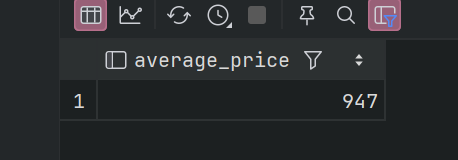

1.2. Среднее кол-во книг 
```
SELECT AVG(amount) as average_amount FROM books;
```
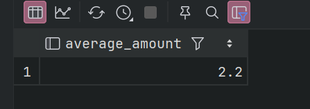

2. количество строк в выборке

2.1. количество строк в жанрах 
``` 
SELECT COUNT(*) FROM genres;
```

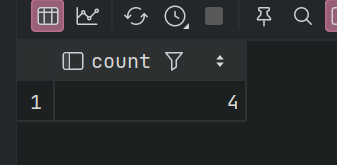

2.2. количество уникальных значение стран в авторах 
```angular2html
SELECT COUNT(DISTINCT country) FROM authors;
```
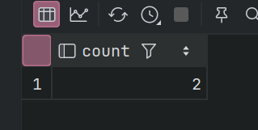


3. Min Max

3.1. Максимальное название книги

```angular2html
SELECT MAX(title) FROM books;
```

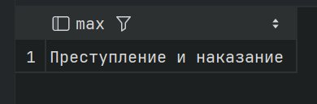

3.2.  Минимальная цена книги
```angular2html
SELECT MIN(price) FROM books;

```

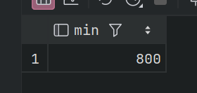

4. Sum

4.1. Сумма от цены на кол-во книг

```angular2html
SELECT SUM(price * amount) FROM books;
```
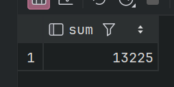

4.2. Сумма всех книг

```angular2html
SELECT SUM(books.price) FROM books;
```
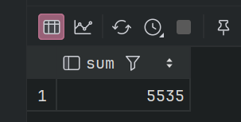


5. STRING_AGG

5.1. Перечислить чз запятую имена всех авторов

```angular2html
SELECT STRING_AGG(name, ', ') FROM authors;
```

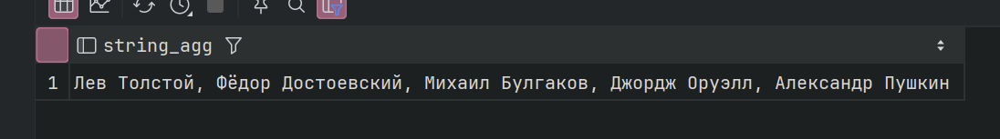

5.2. Перечислить чз запятую названя всех книг

```angular2html
SELECT STRING_AGG(title, ', ') FROM books;
```

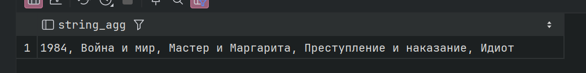


6. GROUP BY

6.1. Статистика по авторам

```angular2html
SELECT
    author_id,
    COUNT(*) AS book_count,
    AVG(price) AS avg_price,
    SUM(amount) AS total_in_stock
FROM books GROUP BY author_id ORDER BY book_count DESC;
```
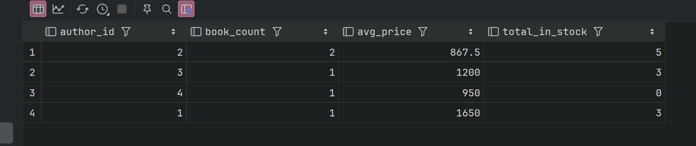

6.2.Кол-во книг с каким-то жанром от автора

```angular2html
SELECT
    author_id,
    genre_id,
    COUNT(*) AS book_count
FROM books GROUP BY author_id, genre_id
           ORDER BY author_id, genre_id;
```

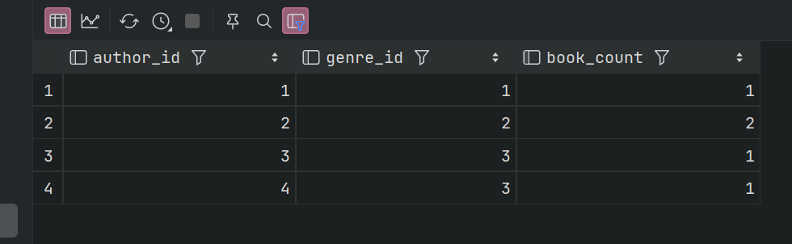


7. HAVING

7.1. Средняя цена книг по жанрам

```angular2html
SELECT genre_id, AVG(price) AS average_price
FROM books WHERE publication_year > 1900
GROUP BY genre_id HAVING AVG(price) > 800;
```
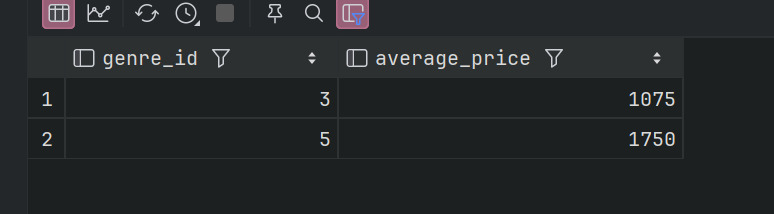

7.2. ищем частого читателя

```angular2html
SELECT reader_id, COUNT(*) AS books_taken_count
FROM loans WHERE loan_date >= '2024-01-01'
GROUP BY reader_id HAVING COUNT(*) > 1;
```

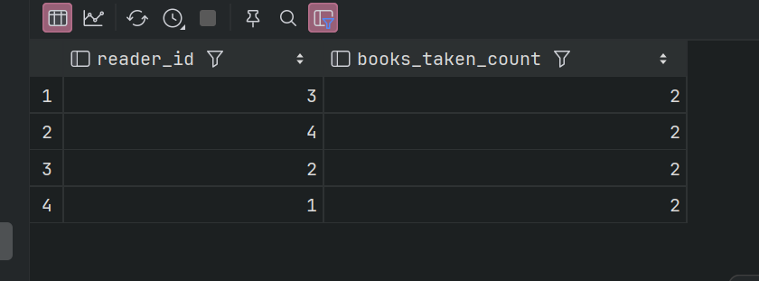


8. Grouping sets

8.1. Выводим общее число книг для каждого жанра
и также суммарные колво для всех жанров и названия книг

```angular2html
SELECT title, genre_id, SUM(amount) AS total_amount
FROM books GROUP BY
               GROUPING SETS ((title, genre_id), (genre_id), ());
```
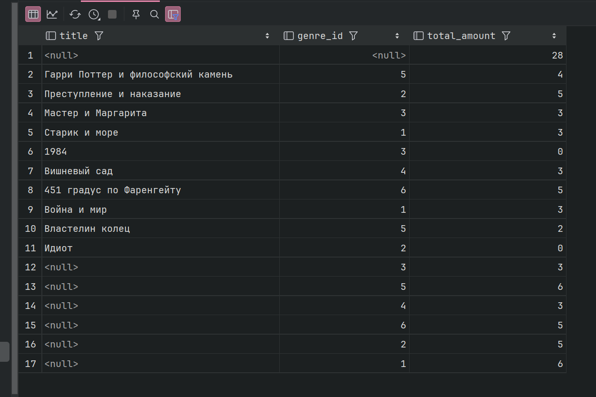

8.2. Выводим общую сумму книг для каждого автора
и также суммарные продажи для всех автора и названия книг

```angular2html
SELECT title, author_id, SUM(price)  AS total_price
FROM books GROUP BY
               GROUPING SETS ((title, author_id), (author_id), ());
```

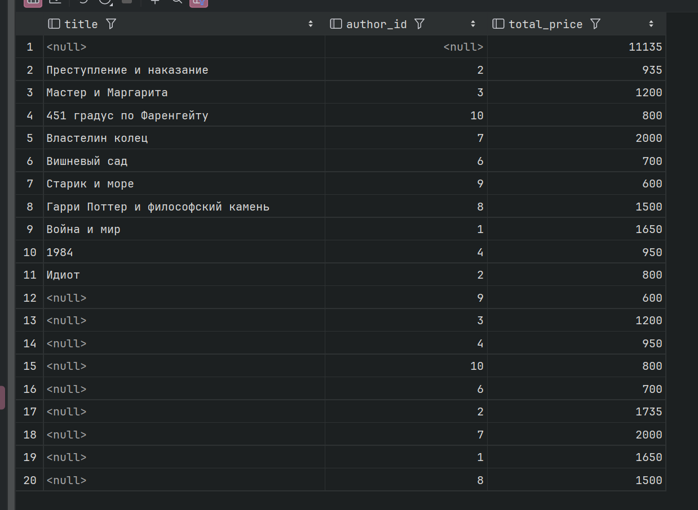


9. ROLLUP

9.1. Выводим общую сумму книг для каждого жанра
и также суммарные продажи  для всех жанров и названия книг
```angular2html
SELECT title, genre_id, SUM(price) AS total_price
FROM books GROUP BY
    ROLLUP (title, genre_id);
```

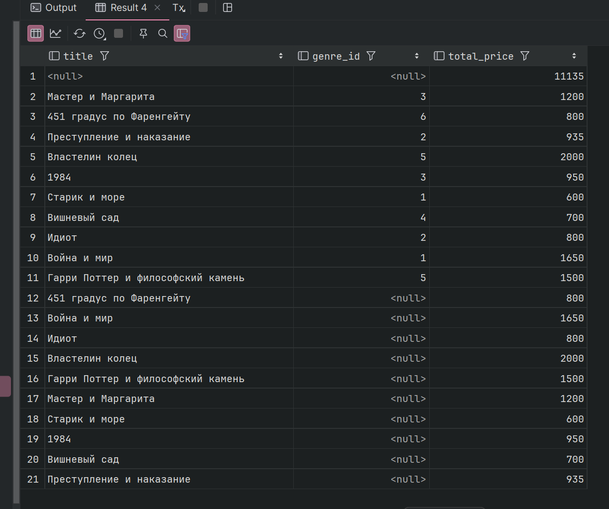

9.2. Выводим общее число книг для каждого автора
и также суммарные колво для всех автора и названия книг
```angular2html
SELECT title, author_id, SUM(amount)  AS total_amount
FROM books GROUP BY
    ROLLUP (title, author_id);
```
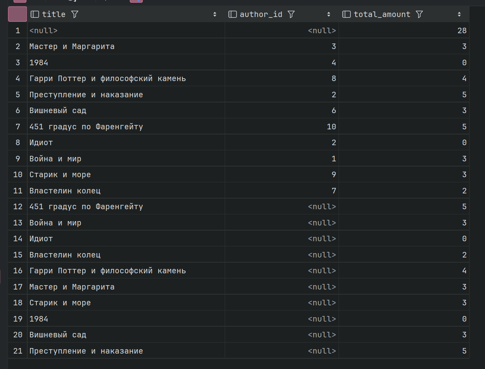

10. CUBE

10.1. Выводим общее число книг для каждого жанра
и также суммарные колво для всех жанров и названия книг
```angular2html
SELECT title, genre_id, SUM(amount) AS total_amount
FROM books GROUP BY
    CUBE (title, genre_id);
```

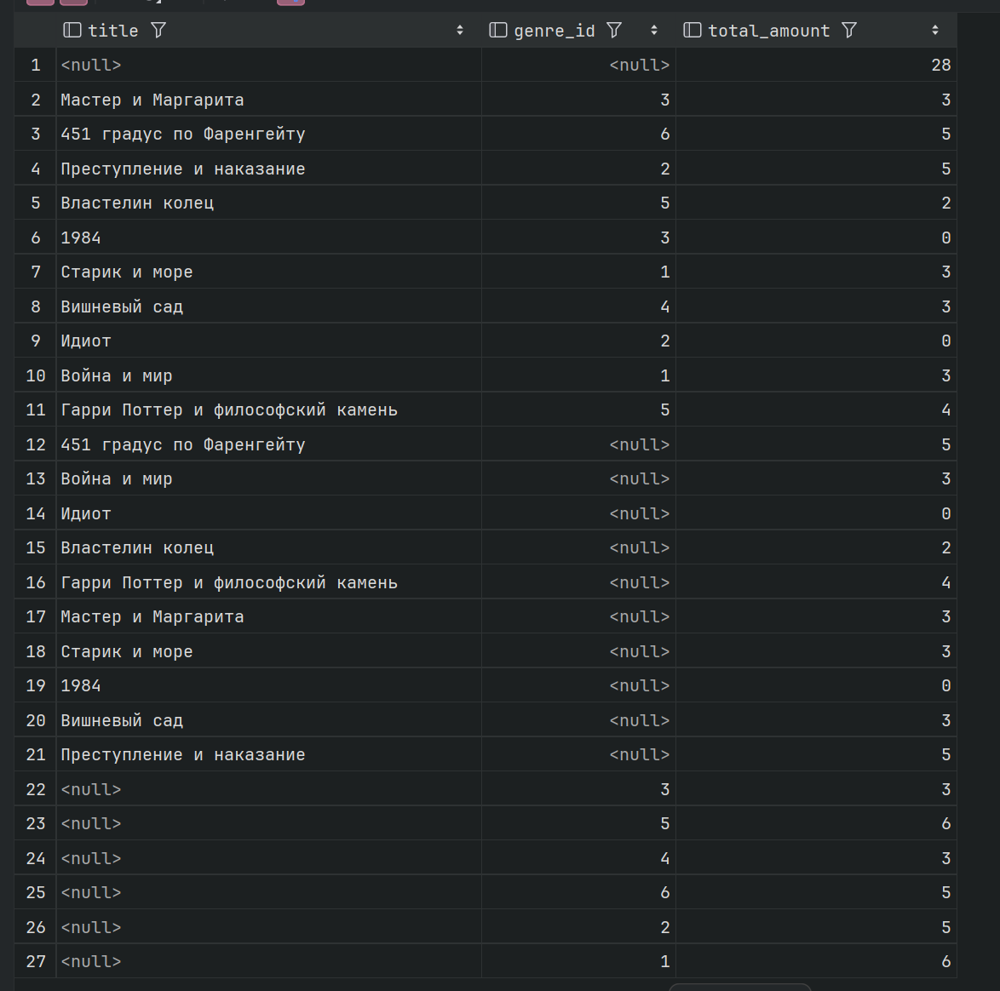

10.2. Выводим общую сумму книг для каждого автора
и также суммарные продажи для всех автора и названия книг
```angular2html
SELECT title, author_id, SUM(price)  AS total_price
FROM books GROUP BY
    CUBE (title, author_id);
```

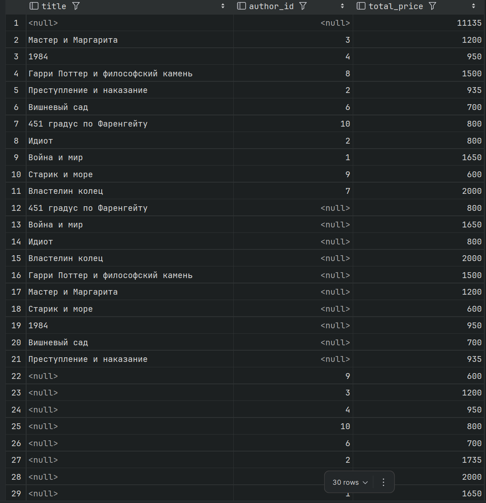

11. SELECT, FROM, WHERE, GROUP BY, HAVING, ORDER BY

11.1. нужно найти читателей, которые брали книги 2 и более раз, 
и отсортировать по убыванию количества выдач
```angular2html
SELECT
    r.id AS reader_id,
    r.full_name,
    COUNT(l.id) AS total_loans
FROM loans l
         JOIN readers r ON l.reader_id = r.id
GROUP BY r.id, r.full_name
HAVING COUNT(l.id) >= 2
ORDER BY total_loans DESC, r.id;
```
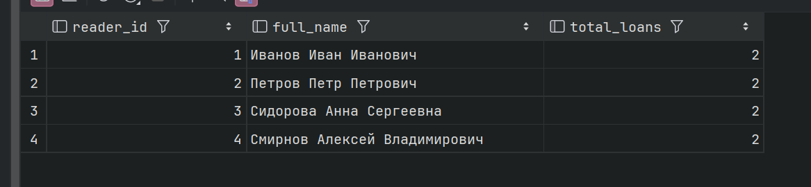

11.2. выбираем жанры, где средняя цена книг > 800 (для книг не старше 1900 года)
```angular2html
SELECT
    g.title AS genre_title,
    COUNT(*) AS book_count,
    ROUND(AVG(b.price), 1) AS average_price
FROM books b
         JOIN genres g ON b.genre_id = g.id
WHERE b.publication_year >= 1900
GROUP BY g.title
HAVING AVG(b.price) > 800
ORDER BY average_price DESC;
```
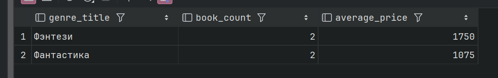
