1. SELECT

1.1. Книги и разница их цены со средней ценой

```
SELECT title,
       price,
       price - (SELECT AVG(price) FROM books) AS diff_from_avg
FROM books;
```
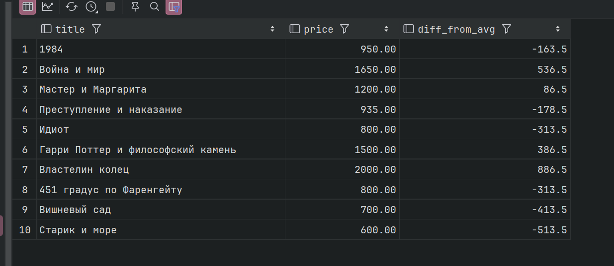

1.2. Книги и максимальная цена в библиотеке

```
SELECT title,
       price,
       (SELECT MAX(price) FROM books) AS max_price
FROM books;
```

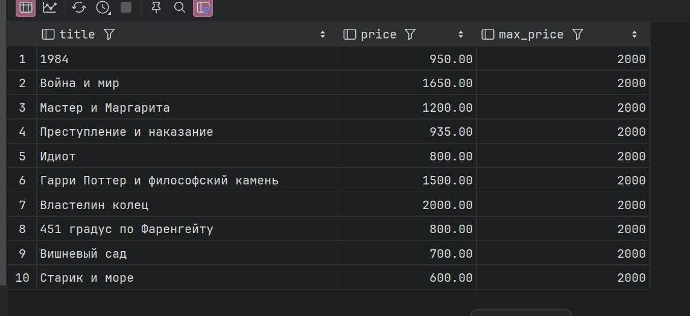

2. FROM 

2.1. Средняя цена книг по жанрам

```
SELECT g.title AS genre, t.avg_price
FROM (SELECT genre_id, AVG(price) AS avg_price
      FROM books
      GROUP BY genre_id) t
         JOIN genres g ON g.id = t.genre_id;
 ```
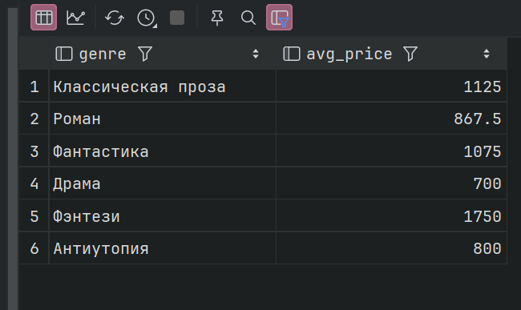

2.2. Количество выдач у каждого читателя

```
SELECT r.full_name, l.loans_count
FROM (SELECT reader_id, COUNT(*) AS loans_count
      FROM loans
      GROUP BY reader_id) l
JOIN readers r ON r.id = l.reader_id
ORDER BY l.loans_count DESC;
```

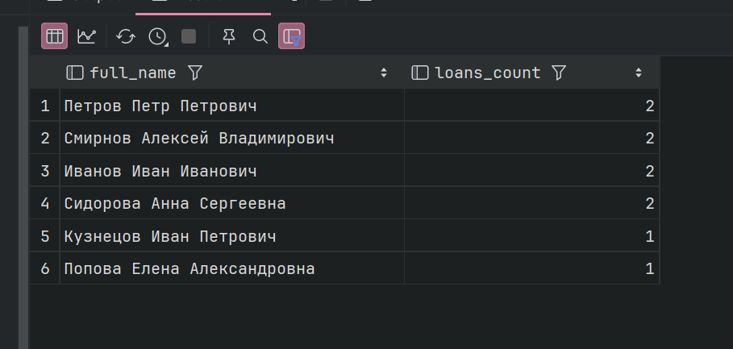


3. WHERE

3.1. Книги дороже средней цены
```
SELECT title, price
FROM books
WHERE price > (SELECT AVG(price) FROM books);
```
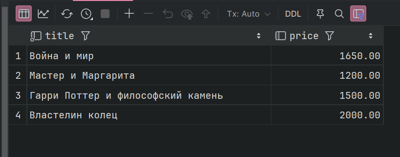

3.2. Самый давний зарегистрированный читатель
```
SELECT full_name, registration_year
FROM readers
WHERE registration_year = (SELECT MIN(registration_year) FROM readers);
```

4. HAVING

4.1. Жанры, у которых средняя цена выше средней по всем книгам

``` 
SELECT genre_id, AVG(price) AS avg_price
FROM books
GROUP BY genre_id
HAVING AVG(price) > (SELECT AVG(price) FROM books);
```
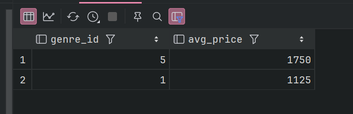


4.2. Авторы, у которых суммарное количество экземпляров больше среднего количества по книге

``` 
SELECT author_id, SUM(amount) AS total_amount
FROM books
GROUP BY author_id
HAVING SUM(amount) > (SELECT AVG(amount) FROM books);
```

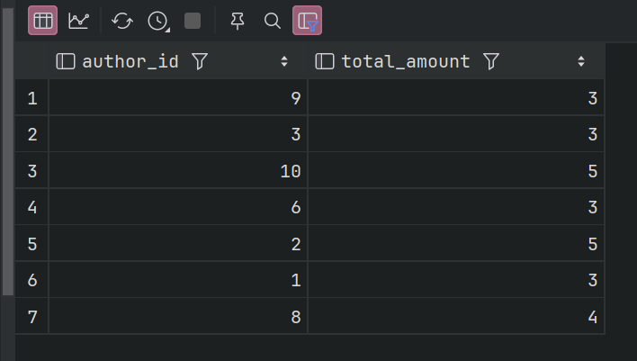

5. ALL

5.1. Книги дороже всех книг жанра «Роман» (id = 2)
``` 
SELECT title, price
FROM books
WHERE price > ALL (SELECT price FROM books WHERE genre_id = 2);
```

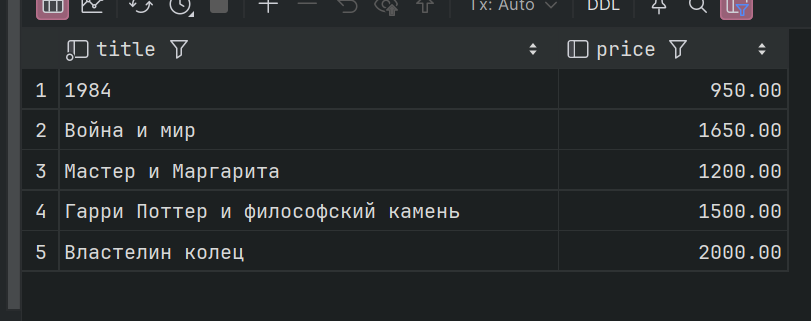

5.2. Книги, изданные раньше всех книг жанра «Фантастика» (id = 3)

``` 
SELECT title, publication_year
FROM books
WHERE publication_year < ALL (SELECT publication_year FROM books WHERE genre_id = 3);
```

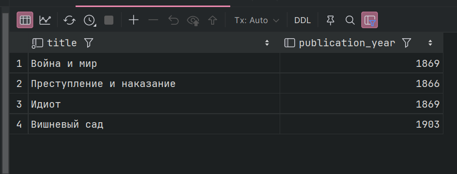

6. IN

6.1. Книги, которые сейчас на руках (не возвращены)
```
SELECT title
FROM books
WHERE id IN (SELECT book_id FROM loans WHERE return_date IS NULL);
```

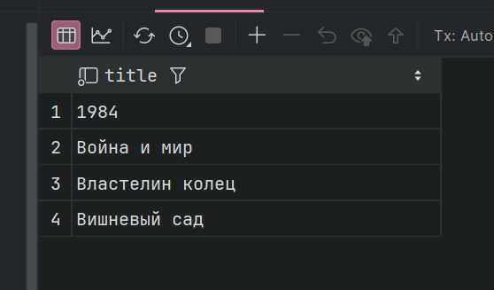

6.2. Авторы, у которых есть книги дороже 1000
``` 
SELECT name, country
FROM authors
WHERE id IN (SELECT author_id FROM books WHERE price > 1000);
```
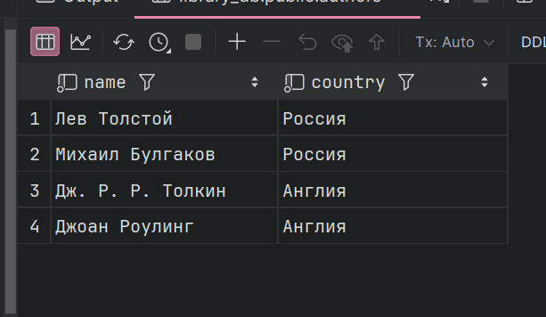

7. ANY

7.1. Книги дороже хотя бы одной книги Достоевского (author_id = 2)

``` 
SELECT title, price
FROM books
WHERE price > ANY (SELECT price FROM books WHERE author_id = 2);
```

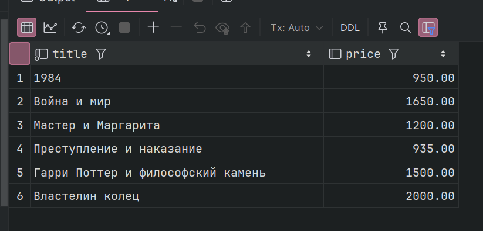

7.2. Читатели, у которых есть невозвращённые книги

``` 
SELECT full_name
FROM readers
WHERE id = ANY (SELECT reader_id FROM loans WHERE return_date IS NULL);
```
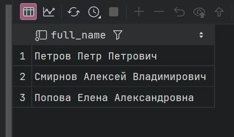

8. EXISTS

8.1. Читатели, которые хотя бы раз брали книги
``` 
SELECT r.full_name
FROM readers r
WHERE EXISTS (SELECT 1 FROM loans l WHERE l.reader_id = r.id);
```

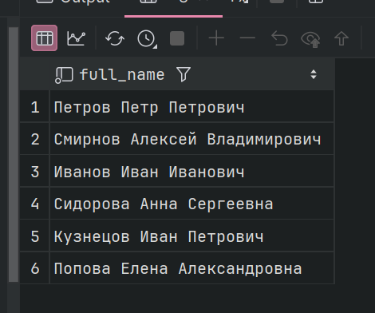

8.2. Книги, которые ни разу не выдавались
``` 
SELECT b.title
FROM books b
WHERE NOT EXISTS (SELECT 1 FROM loans l WHERE l.book_id = b.id);
```

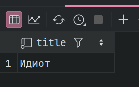

9. Сравнение по нескольким столбцам

9.1. Самая дорогая книга в каждом жанре

``` 
SELECT title, genre_id, price
FROM books
WHERE (genre_id, price) IN (SELECT genre_id, MAX(price)
                            FROM books
                            GROUP BY genre_id);
```

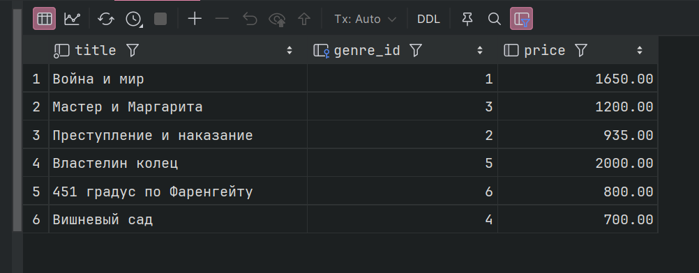

9.2. Самая ранняя книга каждого автора

``` 
SELECT title, author_id, publication_year
FROM books
WHERE (author_id, publication_year) IN (SELECT author_id, MIN(publication_year)
                                        FROM books
                                        GROUP BY author_id);
```
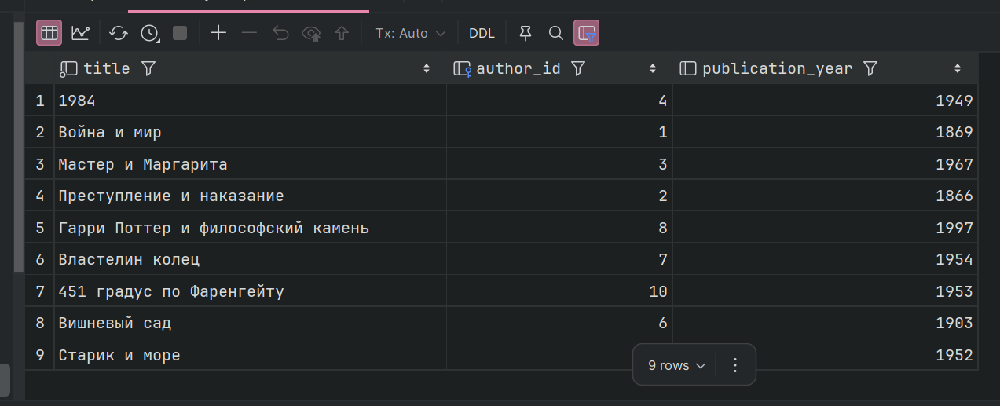

10. Коррелированные подзапросы

10.1 Авторы и количество их книг

``` 
SELECT a.name,
       (SELECT COUNT(*) FROM books b WHERE b.author_id = a.id) AS books_count
FROM authors a;
```
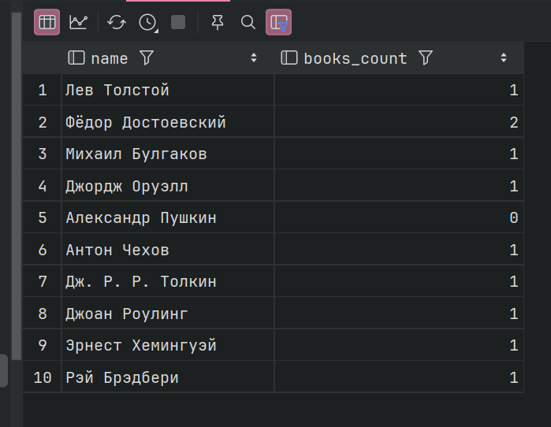

10.2. книги дороже средней цены в своём жанре

``` 
SELECT b.title, b.genre_id, b.price
FROM books b
WHERE b.price > (SELECT AVG(b2.price)
                 FROM books b2
                 WHERE b2.genre_id = b.genre_id);
```

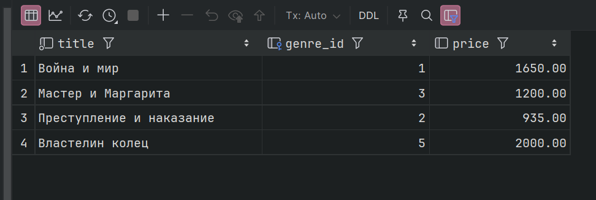

10.3. Читатели, взявшие больше одной книги

``` 
SELECT r.full_name
FROM readers r
WHERE (SELECT COUNT(*) FROM loans l WHERE l.reader_id = r.id) > 1;

```

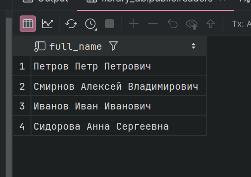

10.4. Книги и дата их последней выдачи

``` 
SELECT b.title,
       (SELECT MAX(l.loan_date) FROM loans l WHERE l.book_id = b.id) AS last_loan_date
FROM books b;
```

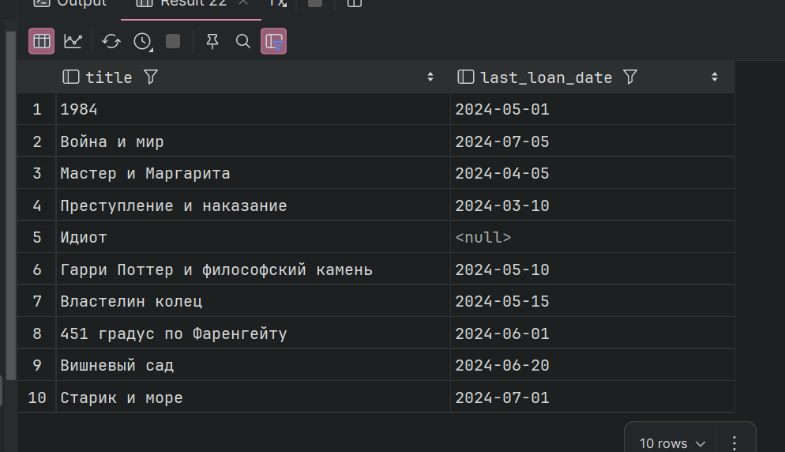

10.5. первая выдача каждого читателя

``` 
SELECT l.id, l.reader_id, l.book_id, l.loan_date
FROM loans l
WHERE l.loan_date = (SELECT MIN(l2.loan_date)
                     FROM loans l2
                     WHERE l2.reader_id = l.reader_id);
```
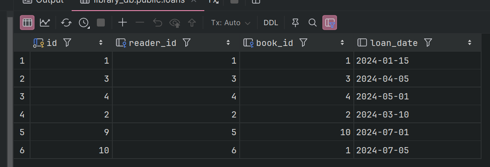