1. CTE

1.1. Получить все книги, написанные русским автором

```sql
WITH russian_books AS (
    SELECT b.* FROM books b
            INNER JOIN authors a ON a.id = b.author_id WHERE a.country='Россия')
SELECT title FROM russian_books GROUP BY title ;
```
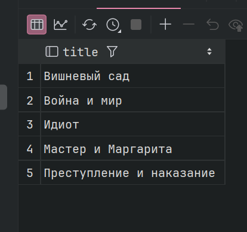

1.2. Получить читателей, бравших книги американских авторов

```sql
WITH usa_readers AS
    ( SELECT DISTINCT r.id, r.full_name FROM readers r
            INNER JOIN loans l ON r.id = l.reader_id
            INNER JOIN books b on b.id = l.book_id
            INNER JOIN authors a on a.id = b.author_id WHERE a.country = 'США')
SELECT full_name AS reader_name FROM usa_readers ;
```

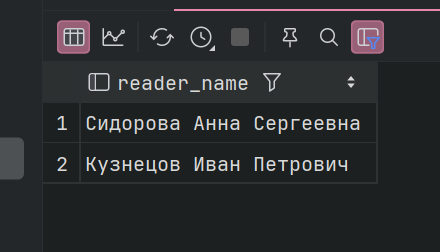


1.3. Получить количество брони каждой книги

```sql
WITH book_loans_count AS
    (SELECT l.book_id, COUNT(*) AS amount FROM loans l
            GROUP BY l.book_id)
SELECT b.title, blc.amount FROM book_loans_count blc
INNER JOIN books b ON blc.book_id = b.id;
```

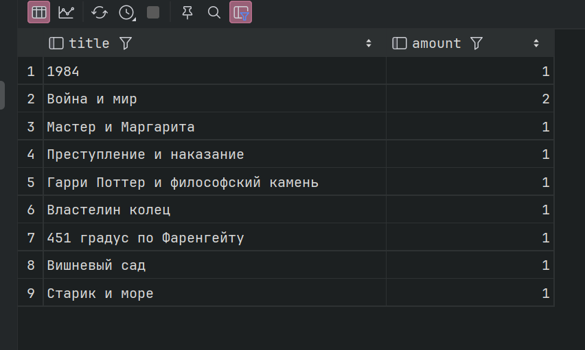

Рекурсии нет, тк у меня нет таблиц которые сами на себя ссылались б 

2. UNION

2.1. UNION: Вывести все книги, которые либо больше 1000 либо изданы до 1900г

```sql
SELECT title FROM books WHERE price > 1000
UNION
SELECT title FROM books WHERE publication_year <1900;
```

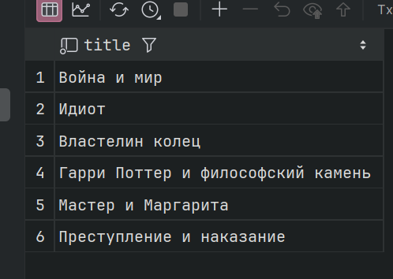

2.2. INTERSECT: Вывести всех читателей 2024го года регистр и у которых книжки не возвращены

```sql
SELECT id FROM readers WHERE registration_year = 2024
INTERSECT
SELECT reader_id FROM loans WHERE return_date IS NULL;
```
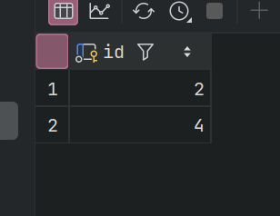

2.3. EXCEPT: книги которые ни разу не брали

```sql
SELECT title FROM books
EXCEPT
SELECT b.title FROM books b
INNER JOIN loans l On b.id = l.book_id;
```

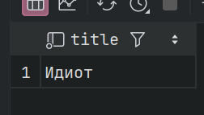

3. PARTITION BY

3.1. цена книги в сравнении с средней по жанру

```sql
SELECT b.title, b.genre_id, b.price,
    AVG (b.price) OVER (PARTITION BY b.genre_id) AS avg_genre_price,
    b.price - AVG(b.price) OVER (PARTITION BY  b.genre_id) AS diff
FROM books b;
```

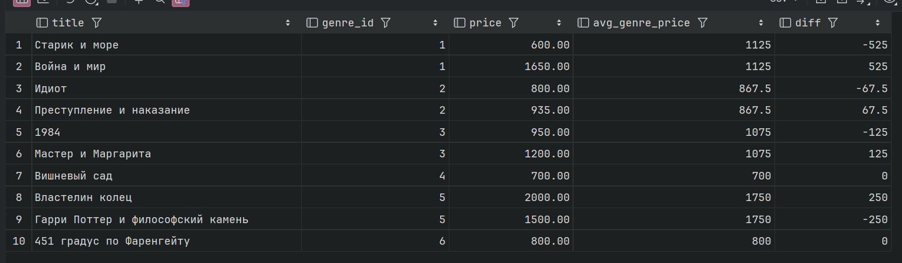

3.2. сколько книг автора и максимальная стоимость его книг

```sql
SELECT b.title, b.author_id,
    COUNT(*) OVER (PARTITION BY b.author_id) AS amount,
    MAX(b.price) OVER (PARTITION BY b.author_id) AS max_price
FROM books b;
```

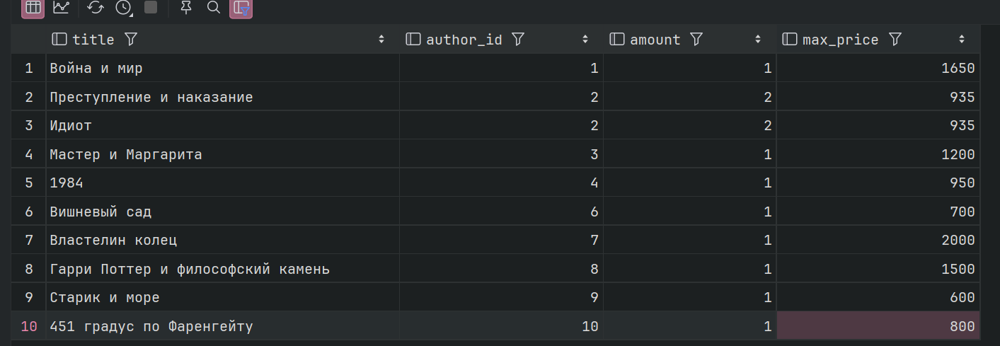

4. PARTITION BY + ORDER BY

4.1. Порядковы номер выдачи читателя 

```sql
SELECT l.reader_id, l.book_id, l.loan_date,
    COUNt(*) OVER (PARTITION BY l.reader_id ORDER BY l.loan_date) AS loan_number
FROM loans l;
```

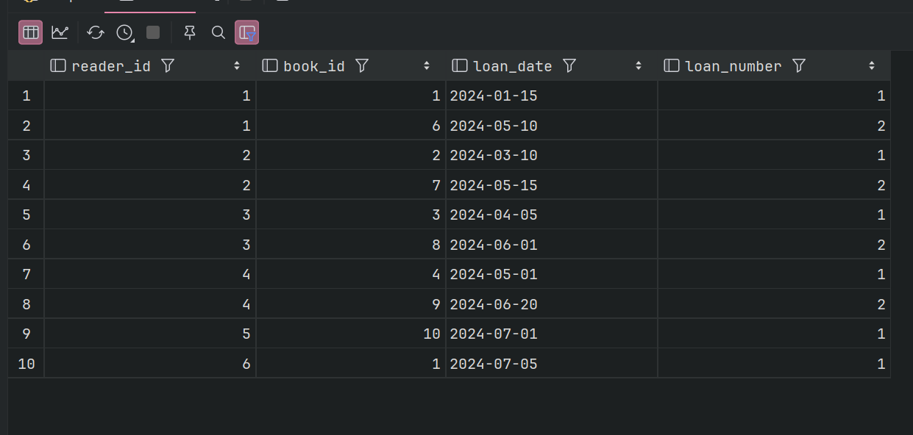

4.2. нарастающая стоимость кнг внутри жанра

```sql
SELECT genre_id, title, price,
       SUM(price) OVER (PARTITION BY genre_id ORDER BY price) AS total
FROM books;
```

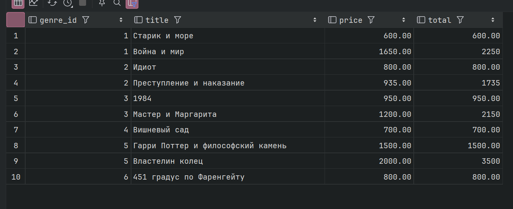

5. ROWS и RANGE

5.1. сумма цен текущей книги и двух предыдущих по году издания

```sql
SELECT title, publication_year, price,
       SUM(price) OVER (ORDER BY publication_year, id ROWS BETWEEN 2 PRECEDING AND CURRENT ROW) AS sum_3_books
FROM books;
```

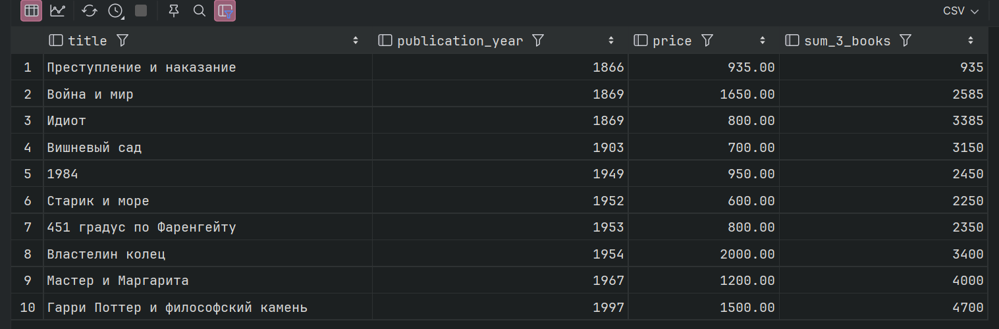

5.2. скользящеее среднее цены (пред, текущая и след книга)

```sql
SELECT title, price,
       ROUND(AVG(price) OVER ( ORDER BY price ROWS BETWEEN 1 PRECEDING AND 1 FOLLOWING ), 2) AS moving_avg
FROM books;
```

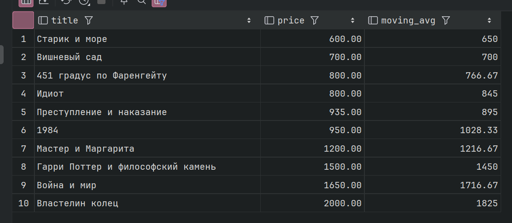

5.3 колво книг изданных за 50 лет 

```sql
SELECT title, publication_year,
       COUNT(*) OVER (ORDER BY publication_year RANGE BETWEEN 50 PRECEDING AND CURRENT ROW ) AS books_last_50_years
FROM books;
```

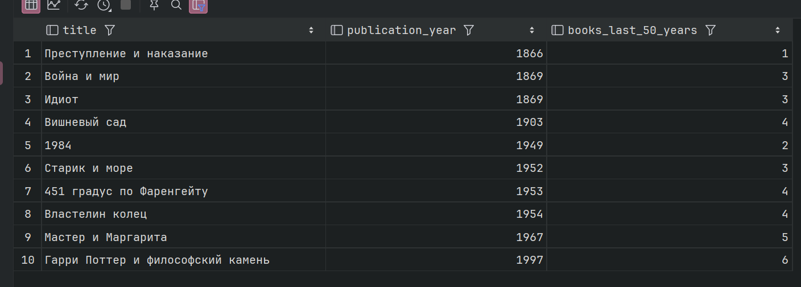

5.4. нарастающий итог цены с учетом одинаковых знач

```sql
SELECT title, price,
       SUM(price) OVER (ORDER BY price RANGE BETWEEN UNBOUNDED PRECEDING AND CURRENT ROW) AS running_total
FROM books;
```

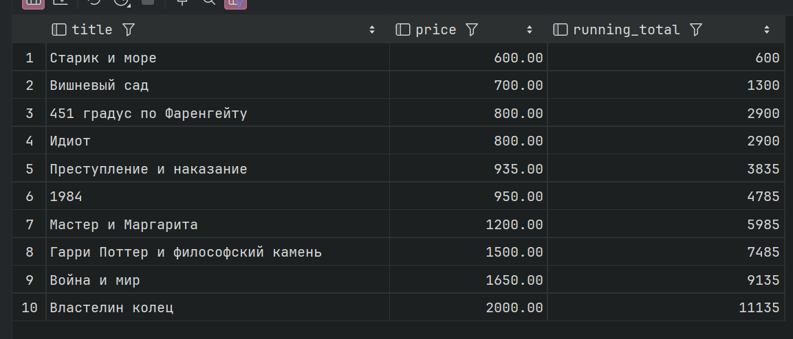

6. ранжирующие

6.1. ROW_NUMBER номер книг в жанре от дорогой к дешевой

```sql
SELECT title, genre_id, price,
       ROW_NUMBER() OVER (PARTITION BY genre_id ORDER BY price DESC) AS rn
FROM books;
```

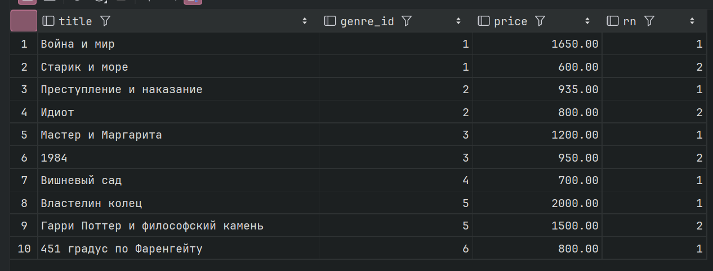

6.2. RANK место книги по цене (с пропусками)

```sql
SELECT title, price,
       RANK() OVER (ORDER BY price DESC) AS rnk
FROM books;
```

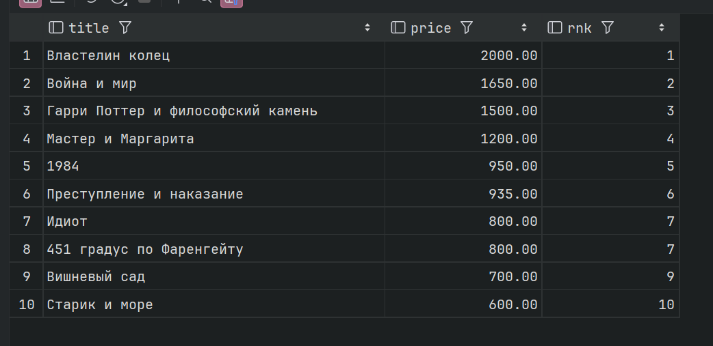

6.3 DENSE_RANK тоже, но без пропусов

```sql
SELECT title, price,
       DENSE_RANK() OVER (ORDER BY price DESC) AS dense_rnk
FROM books;
```

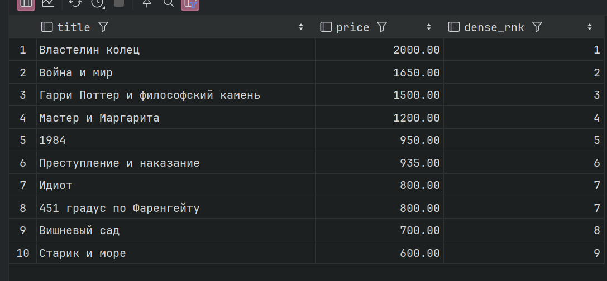


6.4 NTILE разбить книги на 4 ценовые группы 

```sql
SELECT title, price,
       NTILE(4) OVER (ORDER BY price DESC) AS price_group
FROM books;
```
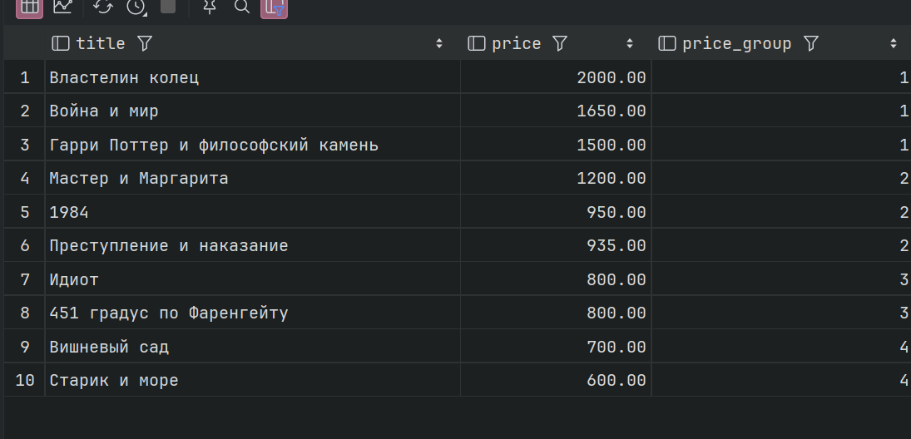


6.5. PERCENT_RANK относительное положение цены от 0 до 1

```sql
SELECT title, price,
       ROUND(PERCENT_RANK() OVER (ORDER BY price)::numeric, 3) AS pct_rank
FROM books;
```

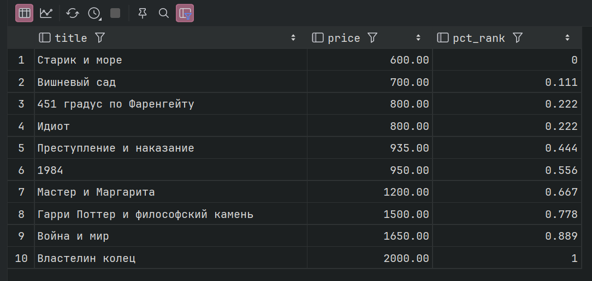

6.6 CUME_DIST доля читателей, зарегистрированных не позже этого года

```sql
SELECT full_name, registration_year,
       CUME_DIST() OVER (ORDER BY registration_year) AS cume
FROM readers;
```
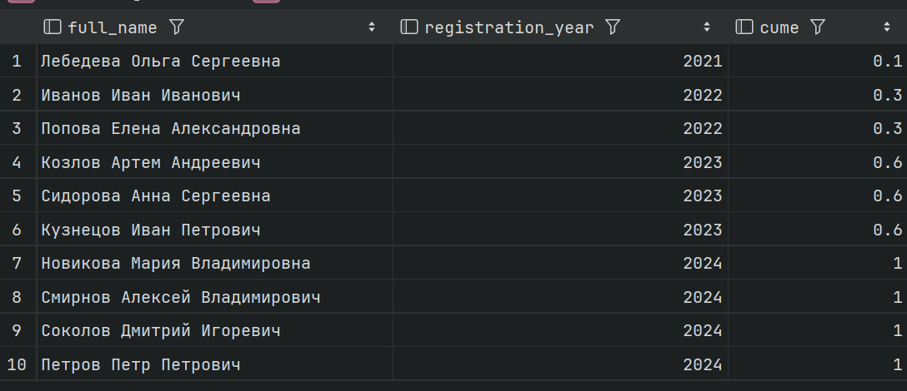

7. Функции смещения

7.1. LAG дата предыдущей выдачи у того же читателя и пауза между ними

```sql
SELECT reader_id, book_id, loan_date,
       LAG(loan_date) OVER (PARTITION BY reader_id ORDER BY loan_date) AS prev_loan,
       loan_date - LAG(loan_date) OVER (PARTITION BY reader_id ORDER BY loan_date) AS days_between
FROM loans;
```

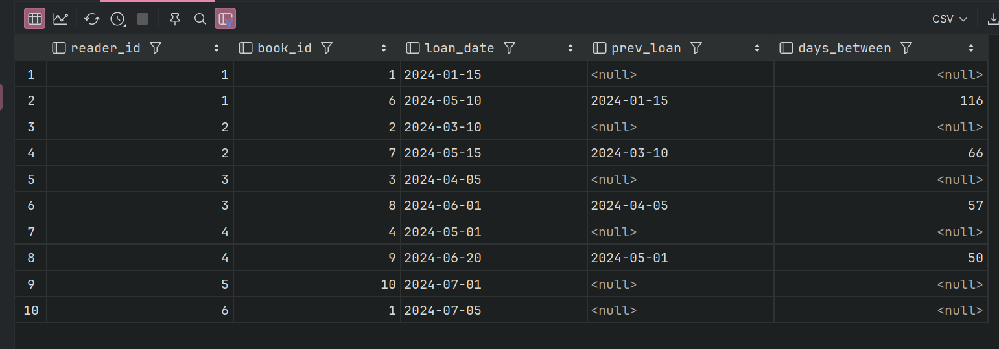

7.2. LEAD какая книга была издана следующей

```sql
SELECT title, publication_year,
       LEAD(title) OVER (ORDER BY publication_year, id) AS next_book
FROM books;
```
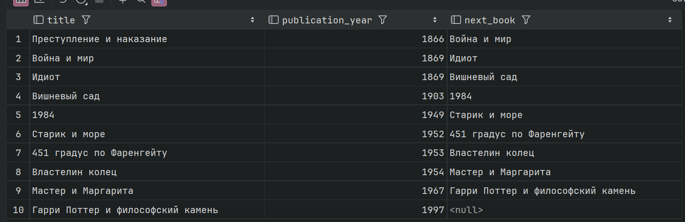

7.3. FIRST_VALUE: самая дешёвая книга своего жанра

```sql
SELECT title, genre_id, price,
       FIRST_VALUE(title) OVER (PARTITION BY genre_id ORDER BY price) AS cheapest_in_genre
FROM books;
```

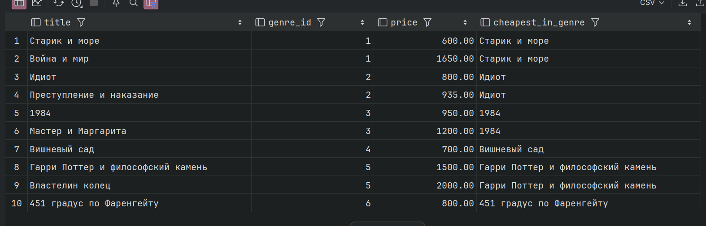

7.4 LAST_VALUE самая дорогая книга своего жанра

```sql
SELECT title, genre_id, price,
       LAST_VALUE(title) OVER ( PARTITION BY genre_id ORDER BY price ROWS BETWEEN UNBOUNDED PRECEDING AND UNBOUNDED FOLLOWING ) AS priciest_in_genre
FROM books;
```

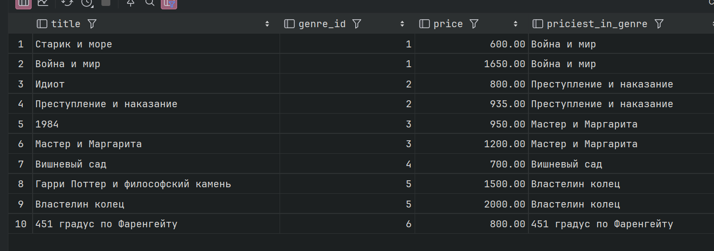

7.5.NTH_VALUE вторая по дешевизне книга в библиотеке

```sql

SELECT title, price,
       NTH_VALUE(title, 2) OVER ( ORDER BY price ROWS BETWEEN UNBOUNDED PRECEDING AND UNBOUNDED FOLLOWING ) AS second_cheapest
FROM books;
```

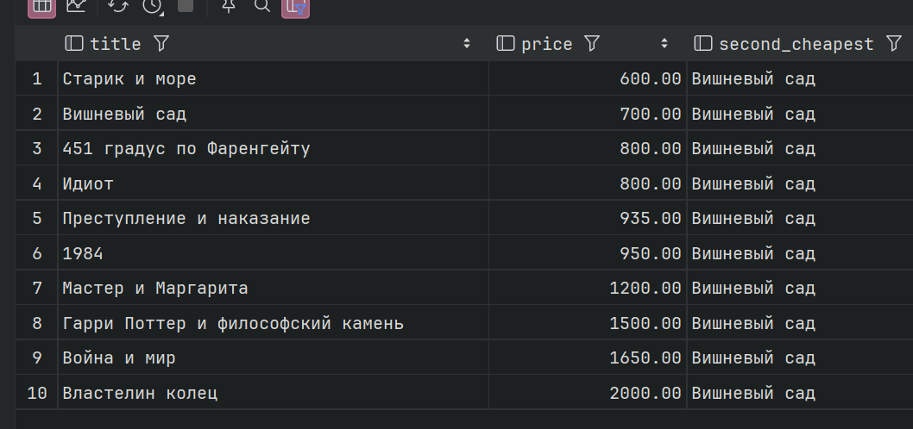