1. Процедуры

1.1. процедура для обновления имени и телефона читателя

```sql
CREATE OR REPLACE PROCEDURE update_reader_info(
    reader_id INT,
    new_full_name VARCHAR(50),
    new_phone VARCHAR(12)
)
LANGUAGE plpgsql
AS $$
    BEGIN
        UPDATE readers
        SET full_name = new_full_name, phone = new_phone
        WHERE id = reader_id;
    END;
    $$;

CALL update_reader_info(8, 'Кузнецова Ольга Сергеевна', '+78005553535');
SELECT * FROM readers WHERE id = 8;
```

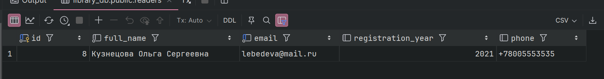
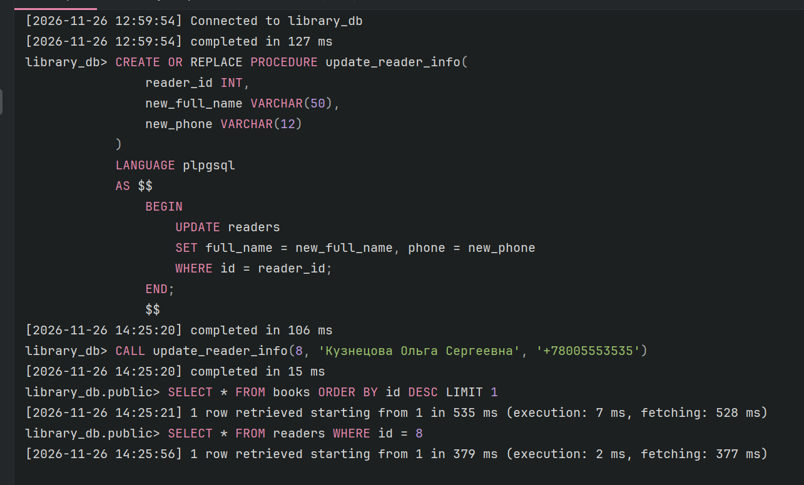


1.2. для добавления новой книги 

```sql

CREATE OR REPLACE PROCEDURE add_book(
    new_title VARCHAR(150),
    new_publication_year int,
    new_author_id int,
    new_genre_id int,
    new_price numeric(10,2),
    new_amount int
)
LANGUAGE plpgsql
AS $$
    BEGIN
        INSERT INTO books (title,publication_year,author_id,
                                  genre_id, price, amount)
        VALUES (new_title, new_publication_year, new_author_id,
                new_genre_id, new_price, new_amount );
    END;
    $$;

CALL add_book('Марсианские хроники', 1950, 10, 10, 700.00, 4)
SELECT * FROM books ORDER BY id DESC LIMIT 1;

```

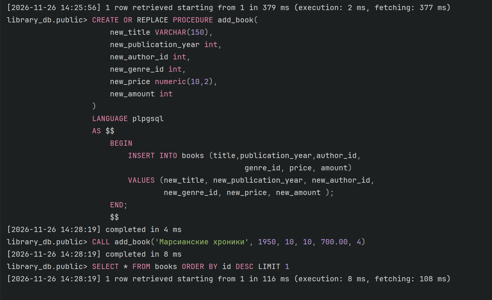

1.3. для добавления нового автора

```sql
CREATE OR REPLACE PROCEDURE add_author(
    new_name VARCHAR(100),
    new_country VARCHAR(50)
)
LANGUAGE plpgsql
AS $$
    BEGIN
        INSERT INTO authors(name, country)
        VALUES (new_name,new_country);
    end;
    $$;

CALL add_author('Айзек Азимов', 'США');
SELECT * FROM authors ORDER BY id DESC LIMIT 1;
```

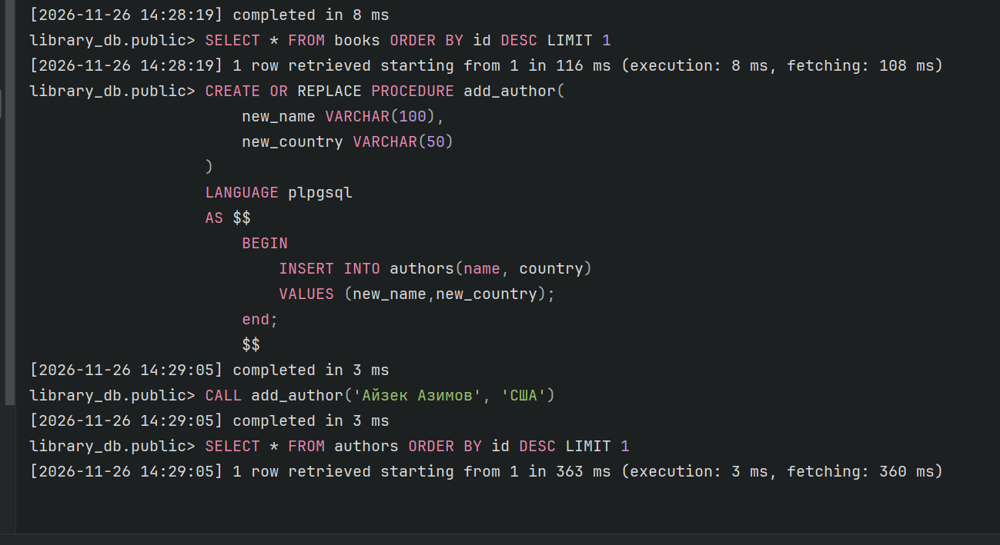


2. Функции 

2.1. считаем книги по жанрам 

```sql
CREATE OR REPLACE FUNCTION count_books_by_genre(g_id INT)
RETURNS BIGINT
LANGUAGE sql
AS $$
    SELECT COUNT(*)  FROM books WHERE genre_id = g_id;
    $$;

SELECT count_books_by_genre(1);
```

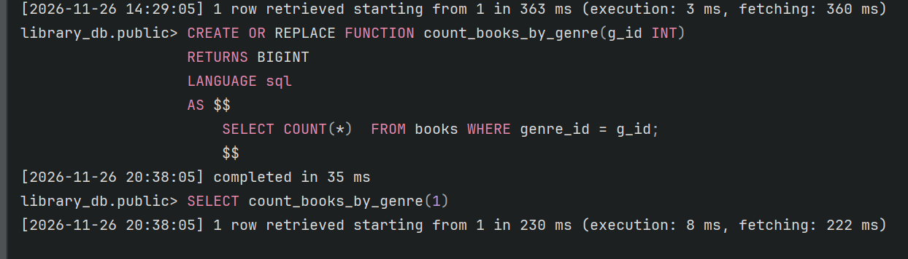

2.2 считаем кол-во записей брони книг читателями 

```sql
CREATE OR REPLACE FUNCTION count_reader_loans(r_id INT)
RETURNS BIGINT
LANGUAGE sql
AS $$
    SELECT COUNT(*) FROM loans WHERE reader_id=r_id;
    $$;

SELECT count_reader_loans(1);
```

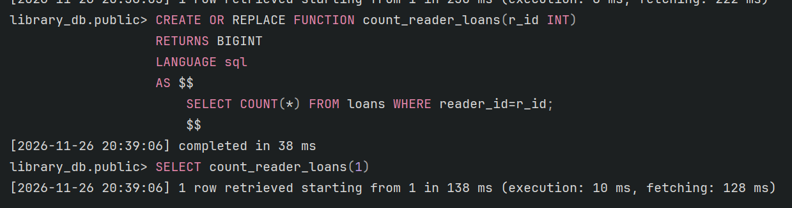


2.3. получаем книги по странам

```sql
CREATE OR REPLACE FUNCTION get_books_by_country(country_name VARCHAR)
RETURNS  TABLE (book_title VARCHAR, author_name VARCHAR, book_price NUMERIC)
LANGUAGE sql
AS $$
    SELECT b.title, a.name, b.price FROM books b
    INNER JOIN authors a on a.id = b.author_id
    WHERE a.country = country_name;
    $$;

SELECT * from get_books_by_country('Россия');
```

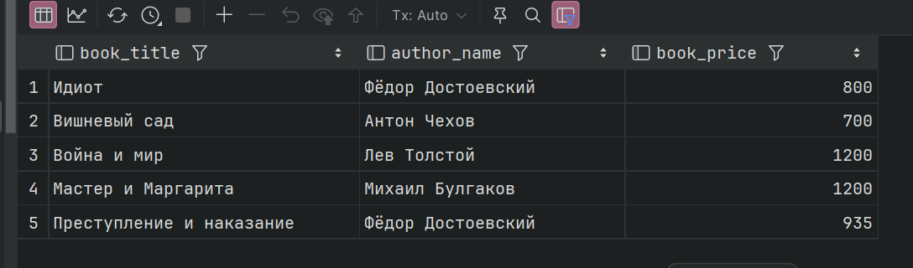
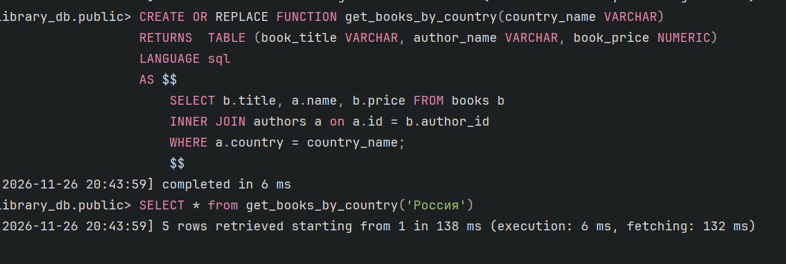


3. функции с переменными

3.1. выводим новую цену со скидкой

```sql
CREATE OR REPLACE FUNCTION price_with_sale(b_id INT, sale NUMERIC)
RETURNS NUMERIC
LANGUAGE plpgsql
AS $$
    DECLARE new_price NUMERIC;
        BEGIN
        SELECT price INTO new_price FROM books WHERE id= b_id;
        RETURN ROUND(new_price * (1-sale/100), 2);
    end;
    $$;

SELECT price_with_sale(1,10);
```

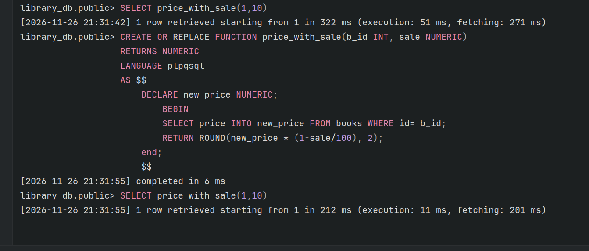
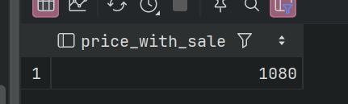


3.2. выводим статус брони книг читателем

```sql
CREATE OR REPLACE FUNCTION reader_status(r_id  INT)
RETURNS TEXT
LANGUAGE plpgsql
AS $$
    DECLARE is_active INT;
        BEGIN
        SELECT COUNT(*) INTO is_active FROM loans
        WHERE reader_id = r_id AND return_date IS NULL;


        RETURN CASE
                   WHEN is_active = 0 THEN 'Все книги возвращены'
                   WHEN is_active = 1 THEN 'Есть одна невозвращённая книга'
                   ELSE 'Есть несколько невозвращённых книг'
            END;
    end;
    $$;

SELECT reader_status(3);
SELECT reader_status(4);

```
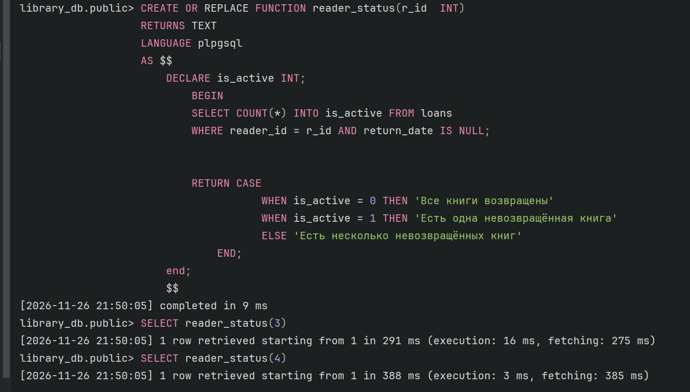
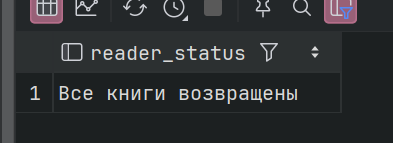
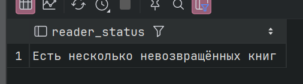

3.3. выводим цену книги и среднюю цену книг 

```sql
CREATE OR REPLACE FUNCTION price_vs_avg(b_id INT)
RETURNS NUMERIC
LANGUAGE plpgsql
AS $$
    DECLARE new_price NUMERIC;
        new_avg NUMERIC;
    BEGIN SELECT price INTO new_price FROM books
    WHERE id = b_id;
    SELECT AVG(price) INTO new_avg FROM books;
    RETURN ROUND(new_price - new_avg, 2);
    END;
    $$;

SELECT price_vs_avg(1);
SELECT price_vs_avg(10);
```

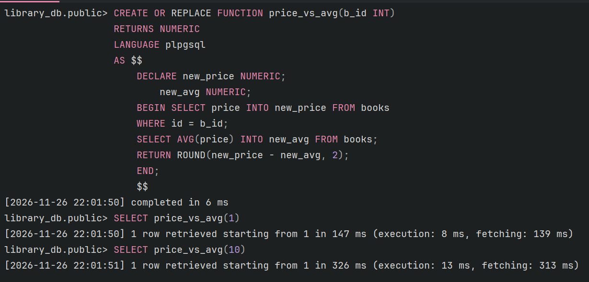
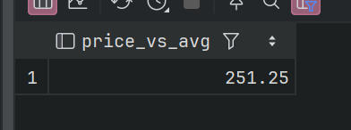
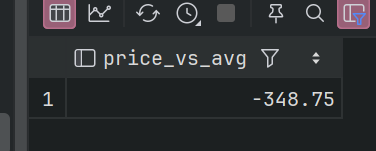


4. Блок DO

4.1. добавляем жанр если его изначально не было 

```sql
DO $$
    BEGIN
        IF NOT EXISTS (SELECT 1 FROM genres WHERE  title = 'Детская литература')
            THEN INSERT INTO genres(title) VALUES ('Детская литература');
    END IF;
    END $$ LANGUAGE plpgsql;

SELECT * FROM genres WHERE title = 'Детская литература';
```

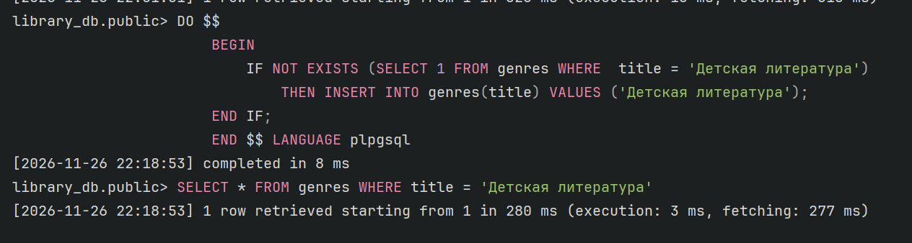
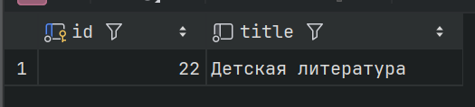

5. IF 

5.1. определяем ценовую категорию книги 

```sql
CREATE OR REPLACE FUNCTION categorize_book_by_price(book_id INT)
    RETURNS VARCHAR(20)
    LANGUAGE plpgsql
AS $$
DECLARE book_price NUMERIC;
    category VARCHAR(20);
BEGIN
    SELECT price INTO book_price FROM books
    WHERE id = book_id;

    IF book_price < 800 THEN
        category := 'Дешёвая';
    ELSIF book_price < 1500 THEN
        category := 'Средняя';
    ELSE
        category := 'Дорогая';
    END IF;

    RETURN category;
END;
$$;

SELECT categorize_book_by_price(1) AS price_category;
SELECT categorize_book_by_price(2) AS price_category;
SELECT categorize_book_by_price(10) AS price_category;
```

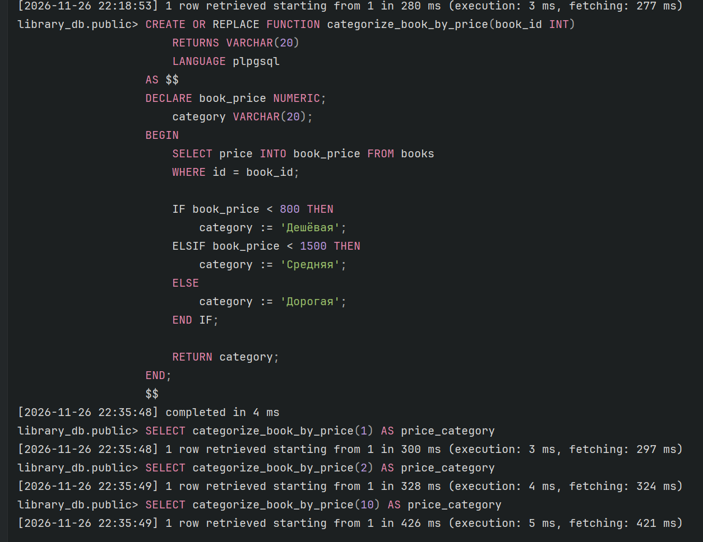
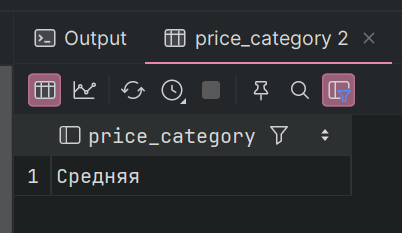
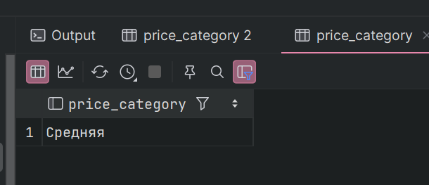
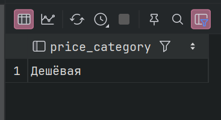

6. CASE

6.1. тоже самое только с case 

```sql

CREATE OR REPLACE FUNCTION categorize_book_with_case(book_id INT)
    RETURNS VARCHAR(20)
    LANGUAGE plpgsql
AS $$
DECLARE book_price NUMERIC;
    category VARCHAR(20);
BEGIN
SELECT price INTO book_price FROM books
WHERE id = book_id;

category := CASE
                    WHEN book_price < 800 THEN 'Дешёвая'
                    WHEN book_price < 1500 THEN 'Средняя'
                    ELSE 'Дорогая'
END;
RETURN category;
END;
$$;

SELECT categorize_book_with_case(1) AS price_category;    -- Дорогая
SELECT categorize_book_with_case(2) AS price_category;    -- Средняя
SELECT categorize_book_with_case(10) AS price_category;   -- Дешёвая
```

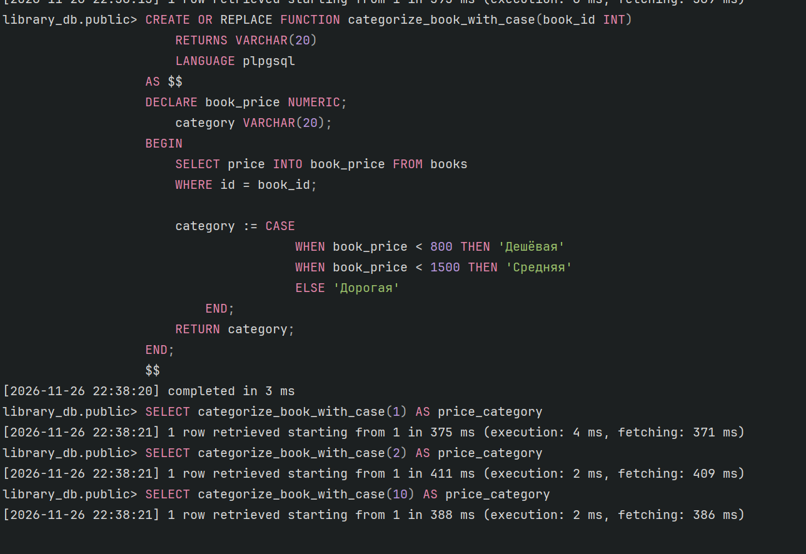

7. WHILE 

7.1. создаем несколько тестовых жанров 

```sql
CREATE OR REPLACE PROCEDURE create_test_genres(count_genres INT)
LANGUAGE plpgsql
AS $$
DECLARE i INT := 1;
    genre_id INT := 100;
BEGIN
    WHILE i <= count_genres LOOP
            INSERT INTO genres (id, title)
            VALUES
                (genre_id + i,'Тестовый жанр ' || i );
            i := i + 1;
        END LOOP;
    RAISE NOTICE 'Создано % тестовых жанров', count_genres;
END;
$$;

CALL create_test_genres(3);
SELECT * FROM genres WHERE title LIKE 'Тестовый жанр%';
```

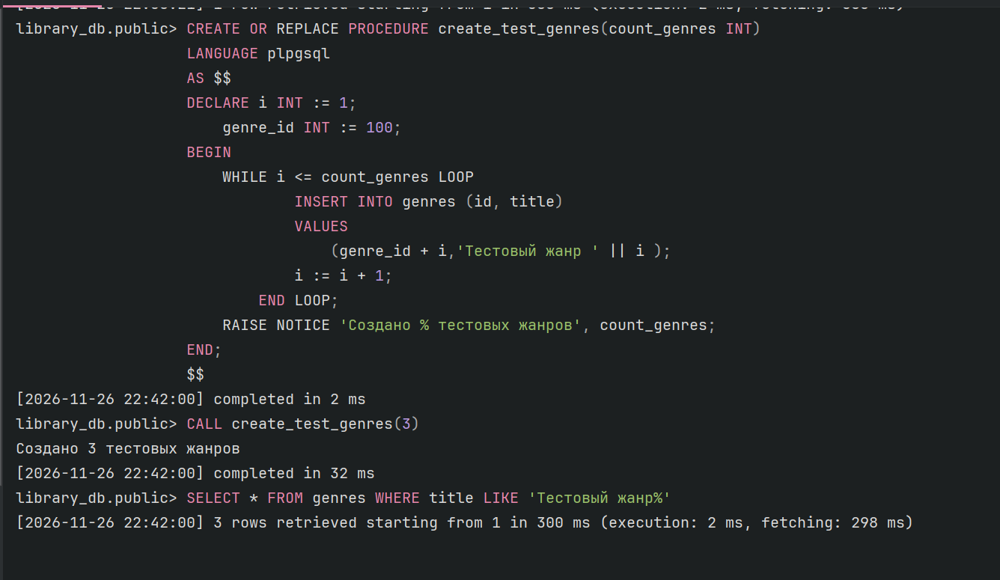
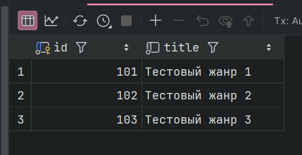

8. EXCEPTION 


```sql

DO $$
    BEGIN
        INSERT INTO genres (id, title) VALUES (1, 'Дубликат');
    EXCEPTION
        WHEN unique_violation THEN
            RAISE NOTICE 'Жанр с таким id уже существует';
    END $$;
SELECT * FROM genres WHERE title = 'Дубликат';   -- пусто
```

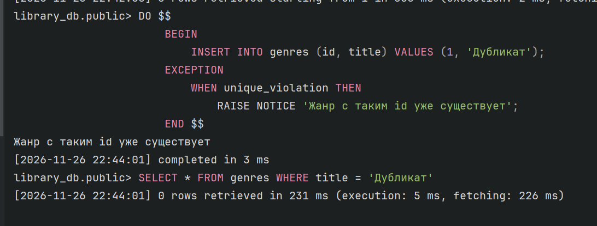

9. RAISE 

```sql

DO $$
    BEGIN
        RAISE DEBUG 'Это сообщение уровня DEBUG';
        RAISE INFO 'Это сообщение уровня INFO';
        RAISE NOTICE 'Это сообщение уровня NOTICE';
        RAISE WARNING 'Это сообщение уровня WARNING';
        RAISE EXCEPTION 'Это сообщение уровня EXCEPTION, выполнение прервано';
    END $$;
```

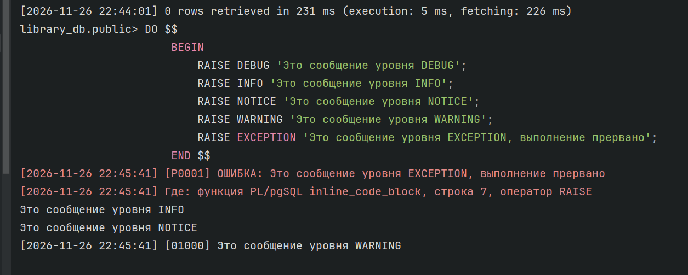

10. Итоге

```sql
SELECT routine_name, routine_type FROM information_schema.routines
WHERE routine_schema = 'public' AND routine_type = 'PROCEDURE';

SELECT routine_name, routine_type, data_type AS returns FROM information_schema.routines
WHERE routine_schema = 'public' AND routine_type = 'FUNCTION';
```

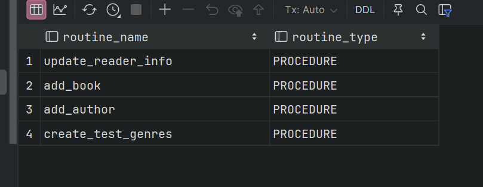
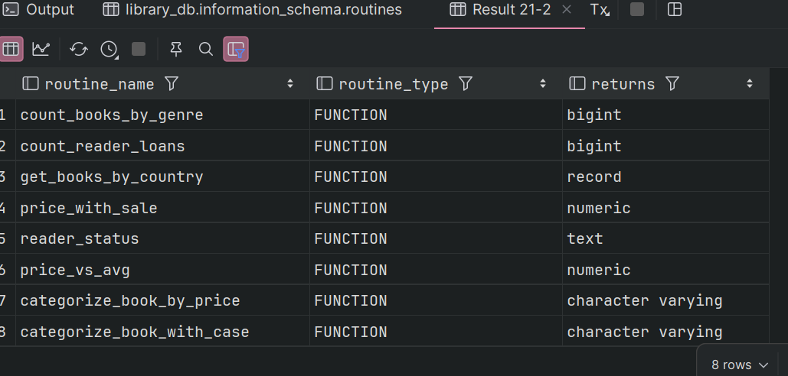